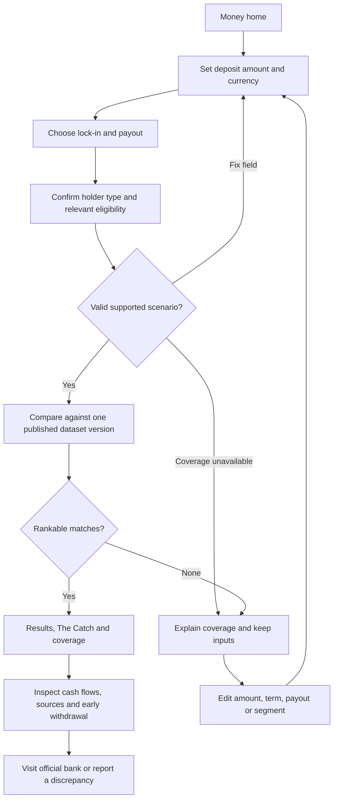
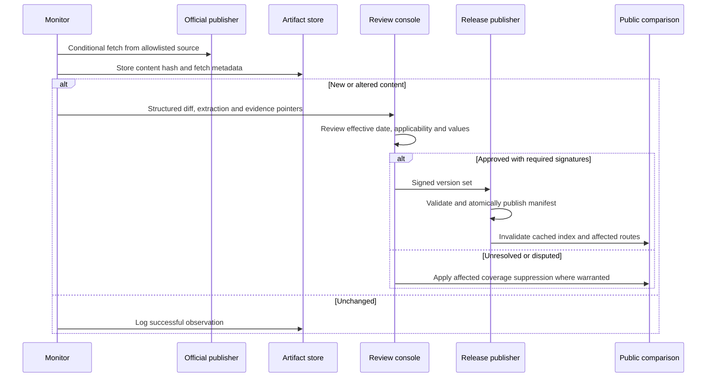

# The No Series
## No. 01 — Money · Product and implementation blueprint

**Edition 1 · 23 November 2026 · Nepal · English / नेपाली**

**Product promise:** See what you could earn or pay, what could change the outcome, and where each figure comes from.

This edition reconstructs the blueprint from the accessible “Website Building Request” brand discussion and the current product brief. The earlier Markdown file was unavailable and the referenced chat exposed no attachments. The starting product scope, release sequence, and design tokens below are implementation decisions. No live bank offer or tax rate is asserted here.

## 1. Product and brand

The No Series is the umbrella. **No. 01 — Money** is the first public product, with **no.** as a compact typographic signature to develop into an original mark. Use **Know before you choose** as the calm public line. “No hype. Just receipts.” can work for editorial campaigns. Product copy should use ordinary language, especially when money is at stake. The brand and domain remain working choices pending clearance.

Start with one Nepal-focused platform and one useful decision. Launch personal NPR fixed deposits first, then expose institutional and foreign-currency segments only when their eligibility, terms and comparison logic pass the same release gates. Show these segments as coverage gaps if users select them before launch. Expand Money to savings accounts, debit and dollar cards, and transfer scenarios with eligible cost models. Loans need their own payment, APR, variable-rate and fee methodology before comparisons. Future series for restaurants, travel, education and movies share the visual language, corrections pattern, source viewer and The Catch. Each needs its own evidence, ranking, editorial and commercial policies. Community reviews can later supply experience context with moderation and provenance. Published bank facts come from authoritative evidence.

**The Catch** is a visible summary of decision-changing conditions. An FD example might concern repricing if withdrawn early, a minimum holding period, an eligibility restriction, a tied account or renewal at a then-current rate. A dollar card example could cover issuance, reload, renewal and cancellation as distinct events. Each verified warning cites the field and source that supports it. Unknown material terms get a visibly different “We couldn’t verify this” label. A warning should say what can happen, when it applies and what the user can check. Allow staff to correct the underlying fact before updating any derived warning.

Publish source code, methodology, policy, fixture-generation instructions and issue templates. Proposed code license is AGPL-3.0-or-later, subject to maintainer approval. Publish data and source extracts only where rights allow, with separate terms and per-source attribution. Keep reviewer identities and raw operational logs private. Support structured corrections through a low-data form and public change notes.

**Revenue.** Use directly sold, contextual placements with clear “Advertisement” / “विज्ञापन” labels. Reserve placement dimensions to avoid layout shifts. Wide layouts may have one side slot after the user sees the comparison. Mobile may have one below the comparison or guide content. Keep search, setup, evidence panels, tables and export free of placements. No third-party tracking requirement, interstitials, sticky ads, or financial-scenario targeting. Ad code receives page and locale context only. Sponsors get no control over eligibility, data state, inclusion, order or warnings. Publish this policy and test equality between sponsor-on and sponsor-off results.

## 2. Fixed-deposit journey

| Step | What the user sees and does | Responsive behavior and outcome |
|---|---|---|
| Discover | “Compare fixed deposits in Nepal” / “नेपालका मुद्दती निक्षेप तुलना गर्नुहोस्”. Supporting line “See estimated interest and check the terms before you deposit.” Primary action “Compare fixed deposits” / “मुद्दती निक्षेप तुलना गर्नुहोस्”. | One prominent action. Link to methodology near the supporting text. On mobile open the guided route with browser Back intact. |
| Amount and currency | “How much will you deposit?” / “कति रकम जम्मा गर्नुहुन्छ?” Amount and currency paired. NPR preselected visibly. Include a grouped-format example and allow English or Devanagari digits. Reject ambiguous separators, negatives, zero, unsupported precision and overflow. | Use a labeled text field with decimal input mode, preserve entered text on errors and normalize only valid input. Foreign currency stays in its own unit and never substitutes NPR or uses implicit FX. |
| Term and payout | “How long can you leave it deposited?” Preset quick choices and a custom number with days, months or years where supported. “When do you want interest paid?” At maturity, monthly, quarterly, or any verified schedule. | Choices wrap. Include the estimated maturity date if exact date arithmetic is supported. Explain that the principal stays locked even if interest is paid monthly. “Any schedule” lets users explore with payout modes labeled. |
| Eligibility and assumptions | “Who will hold the deposit?” / “निक्षेप कसको नाममा राख्ने?” Individual / Institutional explicit. Ask only the eligibility facts required by active products, such as qualifying remittance status. No names, account numbers or documents. Advanced section shows deposit date, tax treatment, payout and compounding definitions. | Show a single summary before submit. Run comparisons with today in Nepal by default and disclose it. Explicit hypothetical tax input creates a separately labeled estimate and never changes the verified methodology. |
| Results | Scenario summary + “Edit details”. “Verified matches in our coverage” with count, date and coverage link. Cards show bank/product, nominal annual rate, estimated net interest when available, payout, estimated maturity or scheduled payments, and a visible Catch if material. Show gross and deductions on expansion. | Desktop compact table with a detail panel and optional side-by-side view. Mobile stacked cards with the same primary facts, up to three pinned products and a full-width comparison view. Preserve scroll and focus after closing details. |
| Investigate | “View sources” / “स्रोत हेर्नुहोस्”. Show original publisher, title, durable link, row/page/section, effective dates, last verification, status, and version. “If you withdraw early” surfaces policy, lock-in conditions, repricing, fees and limits. | Inline or accessible dialog/dedicated page. Offer a withdrawal date only for executable, authoritative rules. Explain how prior payouts and tax adjustments are handled if documented. A missing rule yields “Ask the bank how it recalculates interest if you withdraw early.” |
| Decide | “Visit bank” opens the verified official URL with destination identified. “Report a discrepancy” carries the record reference. “How we calculate” exposes the precise formulas and missing fields. | No application forms or credential collection. The journey ends with a well-evidenced shortlist or a clear reason coverage is limited. |



### Wireframe content hierarchy

```text
Money / Fixed deposits                                 English | नेपाली
Compare fixed deposits in Nepal
See estimated interest and check the terms before you deposit.
[Compare fixed deposits]   How comparisons work

Your deposit                 Term and payout              Who is depositing?
Amount       Currency        Lock-in period               Individual / Institutional
[          ] [NPR   v]       [ choices ] [ custom ]       [ Relevant eligibility ]
                             Interest paid [       v]     Calculation assumptions ▾
[Back]                                                    [Compare deposits]

Results for [amount] · [term] · [payout] · [holder]          Edit details
Verified matches in our coverage                            Coverage and last update
[Sort by]                                                   [Compare selected]
Bank and product            Annual rate       Estimated net interest        Status
Payout schedule | Estimated maturity / breakdown
The Catch    [evidence-backed summary or clearly stated verification gap]
View breakdown                 View sources                     Visit bank
----------------------------------------------------- end of verified results
Other published offers with incomplete or outdated evidence [show]
```

On mobile show the amount/term summary above results, then primary numbers before secondary actions. Honor keyboard and safe-area space on sticky controls and reserve footer padding. Use links for navigation, radio groups for single choices and a real table with headers for desktop comparison. Keep heading order, control names, field descriptions and visible focus. Focus the first invalid field or the new step heading as appropriate. Announce result count after a completed request once. Dialogs restore focus, trap it while open and close with Escape. Design for 44 × 44 CSS px touch areas where practical, 320 CSS px reflow, 200% text resizing and reduced motion. Offer a stacked alternative for dense tables. Preserve data and selection across language change, and explain any reset due to revised eligibility.

| State | Response |
|---|---|
| Invalid/empty input | “Enter an amount greater than zero.” Preserve everything. Link error summary to fields. |
| No matching terms | “No verified offers match these details.” Show the coverage scope and offer explicit edits. Never widen eligibility silently. |
| Unsupported segment | “We don’t yet have verified institutional offers for this currency.” Leave input intact and offer an explicit return to eligible options. |
| Unknown tax or payout math | Show eligible published terms and whichever figures can be calculated accurately. Label missing information. Exclude from net ranking. |
| Changed or overdue source | Suppress current rank eligibility. Show “Verification pending” or “Last verified [date]” with historical context in an optional area only. |
| Contradictory terms | Withhold the disputed values and affected rankings. Link to available evidence and explain the discrepancy. |
| Fetch failure / dataset unavailable | Show a retry action. A still-valid pinned snapshot may be used with its status/time. No zero values, fabricated data or older unlabelled fallback. |
| Fresh data while comparing | Keep the request on one revision. Announce a new release and offer refresh, applying normal expiry/revocation to old results. |

**Journey acceptance.** Valid Nepali and English digit input resolve to the same scenario. Stepping back and changing locale preserve the amount, term, segment and payout. An institutional offer cannot match an individual. Currency, term boundaries and minima are tested. Both locales lead to the same release and result order. Every published financial value and Catch is traceable or visibly marked as unknown. One hand can complete core interactions on a small touch screen, and keyboard and screen reader users can complete the same decisions. No matches, missing terms, stale data, a revoked release and transient failures have distinct recovery paths.

## 3. Comparison methodology

A comparison is a function of scenario + published release + methodology version + explicit evaluation time. Freeze the same dataset, eligibility predicates and tax policy across all products for a request. Term units and boundaries are first-class and inclusive/exclusive semantics are explicit. Compare only offers valid on the intended opening date, with verified amount band, currency, holder class and payout compatibility. Preserve ambiguous eligibility as conditional/unverified. A verified publication can still be insufficient to compute return. Default to net-interest order only for comparable schedules and conventions with complete verified inputs. For mixed payouts, group by schedule and explain timing. Show gross-only informational results separately with no net order. An optional annual-rate sort applies only within comparable verified nominal rate types and groups, and never implies a recommendation. Stable ties use normalized institution name followed by stable product/offer ID. Coverage names the institutions assessed, the verified subset, and exclusions. Use “Highest estimated net interest among verified matches” only when the claim is constrained to the same scenario, schedule and coverage. An empty set has no winner.

For a supported simple-interest rule, gross interest = principal × annual decimal rate × contract year fraction. For a supported fixed nominal rate compounded in equal periods, gross interest = principal × ((1 + annual rate / periods per year) ^ number of periods − 1), restricted to exact supported periods. Bank-specific date or stub rules require a schedule engine with explicit conventions. Interest paid out remains outside the balance. Run dated accrual, capitalization, cash payments, withholding and charges in contract order. Determine whether tax is deducted before capitalization, at payout or at maturity from the applicable verified policy. Use decimal arithmetic and currency-specific precision. Round at documented events in the documented mode. If rounding is unspecified, only an explicitly labeled estimate may use a published platform rounding convention, with the potential difference stated and the precision limitation represented in data. Unsupported convention, consequential missing terms or ambiguous rule yield no calculated ranking. Keep gross interest, cash paid, fees, withheld tax, principal returned and retained interest distinct. Net gain over the full term equals all received cash including principal minus funding principal and separate charges. Avoid double-counting deductions already netted in payments. Maturity payment is the final scheduled payment. Total receipts includes earlier payouts. No automatic renewal projection past the selected term.

**Illustrative fixture only.** A fictional NPR 100,000 deposit with simple annual interest of 6%, contract fraction 1, no fee and fictional 10% withholding at payout gives 6,000 gross interest, 600 withheld, 5,400 net interest and 105,400 at maturity. Under four equal simple quarterly payouts, each net interest payment is 1,350 and maturity pays principal plus the final 1,350. These numbers are arithmetic test inputs and carry no banking or tax claim.

For early redemption evaluate a separate scenario with elapsed term, closure eligibility, revised accrual, clawbacks of earlier payouts, penalty/fee and applicable tax adjustments. Decline to simulate if a material input is missing. Show policy text and evidence independently of numeric modeling. Run interest and fee rules for new deposits separately from any legacy contract policy.

**Total ownership cost beyond FD.** Define the scenario horizon and usage vector by category. Publish line items as event × count or amount, then apply percentage basis, tier, minimum, maximum, waiver, timing, taxes and prerequisite costs as applicable. Show issuance, recurring, transaction and exit costs separately and identify when each occurs. Distinguish refundable balances and excluded or conditional charges from fees. Quote “known subtotal” when a material line is unknown. Zero is valid only when explicitly supported. Foreign-currency fees stay in native units unless an explicit source-backed FX quote, timestamp, markup and rounding convention are modeled. Avoid cost ranking when unknowns could alter the order or assumptions differ. Keep optional interest or rewards separate unless a verified scenario explicitly combines them.

## 4. Evidence model and publication

| Entity | Core fields and constraints |
|---|---|
| Institution, Product | Immutable IDs, localized names, aliases, regulatory class, official domain registry, official product URL, kind and status. Model mergers and product successors explicitly. |
| Source registry, Artifact | Publisher, permitted discovery and fetch URLs, scheduled cadence and rights policy. Immutable hash, URL, redirect trail, retrieval time, MIME, restricted snapshot key, original language and parser version. An unchanged fetch updates monitoring history only. |
| Citation | Artifact ID, page/section/table/row coordinates, permitted excerpt, original value and units. Store an alternate official link when available. |
| Offer version | Product, currency, segment, predicates, amount bounds, exact term bounds/unit, nominal rate or schedule, payout mode, minimum days, opening eligibility, validity interval, original effective-date string/calendar and reviewed AD normalization. Link required fact values individually to citations. |
| Rule version | Accrual/day count, compounding, payout/calendar treatment, tax authority and applicability, rounding or estimate policy, fee tiers and waiver predicates, redemption and renewal conditions. Cite each rule and expose calculation support level. Use a constrained schema with enumerated operations. |
| Observation, Candidate, Review | Fetch outcome, extraction/diff lineage, field-level changes and unresolved issues, reviewer decisions and reason, approval/rejection timestamps. Candidate state is distinct from public freshness. |
| Release, Correction | Immutable release manifest and content hash, methodology version, previous release, publication times, supersession/revocation, audit trail and user-facing correction. Atomic current pointer. |
| Scenario, Result | Validated transient input and explicit as-of timestamp; output cash-flow events, coverage/exclusion reasons, order key, release and methodology identifiers. No account profile. |
| Catch | Severity, trigger, localized consequence/next action, dependencies and evidence refs. Recompute for scenario and suppress when evidence is insufficient. |

Use typed decimal storage and APIs that serialize money/rates as strings. Distinguish unknown, inapplicable, verified zero and unsupported. Temporal data separates publication date, effective interval, retrieved time, human verification and next review deadline. Use Nepal calendar display only when validated against preserved source text; store normalized comparison boundaries in `Asia/Kathmandu` with explicit day semantics. Never equate an upload timestamp with effective date. Reject overlapping conflicting active offer keys unless version precedence can be proven. Future-effective offers remain scheduled and excluded from today’s comparison. Authoritative rate notices support rates. Tariffs support charges. Product terms support conditions. NRB establishes roster and regulatory context. IRD, applicable Finance Acts and qualified review establish versioned tax assumptions. Bank support correspondence can guide research. A privately reported claim cannot substitute for publicly traceable evidence.

**Public status.** Verified means the relevant fields passed human review, apply to the scenario’s date and are within freshness policy. Pending means changed evidence awaits review. Stale marks a missed verification deadline. Expired means outside the effective interval. Conflict means applicable sources disagree without a confirmed precedence. Unavailable means current evidence could not be established. Show both date and status in the interface. Initial operating targets are daily discovery for rate notices, more frequent near known scheduled changes where permitted, weekly tariff checks and manual re-verification no later than 31 days for rates or 90 days for tariffs/terms, or sooner at any disclosed expiry or credible change. These are service targets. Flag and suppress only affected rank-critical facts and their dependent offers on confirmed conflicts, material change, known expiry or freshness breach. Broken links trigger recheck and reviewer triage, with suppression when current evidence is no longer supportable. A successful poll cannot extend a review deadline.



**Ingestion runbook.** Register first-party domains and endpoint policy manually. Follow robots and terms, conditional requests, per-origin limits, capped retries with jitter, timeout, byte and page caps. Acquire a per-source lease and use content hash/webhook idempotency. Retain raw artifacts privately where allowed. Extract HTML, PDF tables or OCR in isolated jobs with provenance and confidence. Normalize numerals, rate notation, headings and date candidates, then diff by semantic key and source locator. A confidence score routes work, never approves it. Map dependency blast radius, escalate changed rates, missing rows, widened eligibility, tax changes, source disappearance or duplicated temporal ranges. Nonmaterial changes can be closed by a reviewer without publishing. Reviewers see old/new snapshots, original and normalized values, source date, downstream effects and calculation previews. Require separate second approval for first production entry, material financial changes, tax policy and emergency restorations. Transactionally commit data + pointer + outbox; retry cache invalidation idempotently. A correction can suppress one offer immediately. Rollback can activate a prior manifest only after revalidating date, revoked facts and freshness. Alert on queue age, repeated fetch failures, near-expiry coverage and publish failures; assign each to an owner and a runbook.

## 5. Architecture and delivery

Use TypeScript and Next.js App Router for the public experience and server routes on Vercel, preferably in one repo with clear module boundaries. Use Postgres for verified records, revision metadata and editor audit; private object storage for permitted artifact snapshots. Keep scheduled fetch/extraction in an isolated worker or managed job runner. Vercel Cron can dispatch scheduled work after verifying the selected plan supports the required frequency. Keep comparison pure and testable without Vercel, network or database. Use groups such as `app/`, `components/`, `domain/`, `data/`, `ingest/`, `messages/`, `tests/`, and `docs/`, adapting to existing conventions. No administrative service credentials in client bundles. Public routes read a constrained view and expose calculation/citation models only. Build a restricted reviewer console with role separation, SSO/MFA, CSRF safeguards, audit and server-enforced authorization.

Use localized canonical routes under `/en/money` and `/ne/money`, including `/fixed-deposits`, `/fixed-deposits/compare`, `/methodology`, `/coverage`, and `/sources/[id]`. Use a validated POST for scenario comparison if an API is needed, with no raw scenario logs, caching by neither URL nor ad identity. Default to session-scoped memory for form state with explicit reset. Publish public source and coverage pages with version-consistent cache invalidation. Never serve data after a known expiry or revocation from a stale CDN entry. Version API outputs and return machine-readable distinctions for validation, empty matches, unsupported coverage and temporary outage.

Threat model includes arbitrary fetch destinations, unsafe redirects and DNS rebinding, untrusted documents, XSS in extracted text, unauthorized publication, CSRF and abuse. Limit outbound fetches to the allowlist and block private/reserved IPs across redirects, enforce controlled egress, isolate parsing with time/memory caps, escape all evidence text and use safe link protocols. Secure preview environments, use separate DBs and object stores, rotate credentials, rate-limit public forms and worker/admin routes, redact logs, and test backup restoration. Use least privilege, security headers and CSP that accounts for first-party ad placements. Collect aggregate operational and experience metrics only. Publish methodology and privacy disclosures. Verify retention and source rights before launch.

## 6. Design system and quality bar

Warm editorial light surfaces, crisp geometry, confident typography and one restrained accent. Develop the distinct no. signature as original typography. A compact “No. 01 — Money” identity anchors a task-first homepage. Avoid hardware motifs, copied logos, dot-matrix display type, gratuitous gradients, dashboard clutter and promotional rankings. Compose around a calm amount input, visible choice hierarchy, aligned numbers and short evidence labels. The signature motion is a second layer that reveals deductions or evidence while the original figure stays visible. Initial screens should be designed at 390 and 1440 CSS px and tested at 320, 768 and intermediate widths. Design the two locales together.

| Token | Starting specification |
|---|---|
| Surface, text | Canvas `#F7F6F2`, panel `#FFFFFF`, text `#171717`, secondary `#56544F`, decorative rule `#DBD8D1`, interactive border `#77746D`. |
| Accents | Action `#193C33`, focus `#245BBC`, warning ink `#754009` on `#FFF2D8`, danger `#A22429`, success `#20533B`. Pair color with text/icons. Verify each rendered pair, including hover and disabled states. |
| Type | Geist or comparable grotesk + Noto Sans Devanagari, locally hosted licensed fonts, system fallbacks. Body 16–18 px, line-height 1.5 EN / 1.65 NE, headings 32–56 px responsive and less tight in Nepali. Tabular alignment for figures where supported. Avoid uppercase or tracking rules on Devanagari. |
| Layout | 4 px micro increments, 8 px base spacing, 16/24/32/48/64 px section spacing, 1120–1200 px content max, 16–24 px mobile gutters, constrained reading width. 8/12/16 px radius hierarchy. |
| Motion | 160 ms controls, 220 ms disclosure, up to 280 ms richer transitions. Animate opacity and small displacement, preserve content order and focus, remove spatial motion under reduced-motion preference. No scroll hijacking. |
| Responsive | Stacked labels/cards at small widths, grid when fields have room, desktop comparison table without presentation-only duplicates read by assistive technology. Reserve ad, icon and font space to avoid shifts. |

Place English and नेपाली switching within reach on every route. Set HTML language and language on mixed snippets. Use locale-specific message catalogs and ICU patterns where helpful. Keep language-independent calculation data separate from UI strings. Agree with a native reviewer on banking terms, local number grouping, lakh/crore explanatory language, digits and numerals display; both digit scripts remain accepted. Show original and normalized effective dates when relevant and let screen readers read a clear date string. Avoid machine-only translation for source conditions and financial copy. Make essential copy usable with fonts blocked and site interactions useful under slow connections.

**Performance and QA.** At the 75th percentile of mobile field traffic target LCP ≤2.5 s, INP ≤200 ms, CLS ≤0.10. Until field data exists, record repeatable mobile lab runs for homepage and results with representative cold cache and a synthetic dataset. Budget initial first-party compressed route JS at ≤180 KiB as a starting target, measure actual output and document any justified exception. SSR index and methodology, minimize client boundaries, defer comparisons’ secondary drawers and first-party ad content, subset fonts with script coverage, and avoid a broad component dependency. Test core methods with table-driven golden cases and independent expected cash flows. Test DB constraints, partial publish, concurrent review, revocation, future start, deadlines, source drift, locale parity, empty matches, adversarial inputs and caching. Use Playwright on desktop and mobile, axe plus manual screen-reader/keyboard tests, and native-language review. Target WCAG 2.2 AA.

## 7. Milestones and ownership

| Milestone | Exit evidence |
|---|---|
| M0 — Product and evidence contract | Confirm supported scenarios, source access/rights, tax review owner, terminology, editorial and ad independence policy. Select pilot institutions based on source completeness. |
| M1 — Design and vertical slice | Original bilingual responsive design and functional fictional-data flow through compare, Catch, citations and unavailable states. Native language and usability feedback addressed. |
| M2 — Deterministic core | Versioned schema, releases, independent fixtures, eligibility, cash flows and fee primitives, canonical ordering and field evidence. Test failure paths as rigorously as positive cases. |
| M3 — Ingestion and verification | Source inventory, monitored adapters, reviewer flow, high-risk approvals, immutable publication, alerts and restoration drill. |
| M4 — Verified private pilot | At least three verified institution examples with genuinely comparable offers for one supported NPR individual scenario as a proposed launch threshold. Offer count, known exclusions, coverage date and source links checked independently. No pressure to fill coverage with guesses. Validate against bank-published terms and manually calculated schedules. |
| M5 — Public release | Protected preview accepted, accessibility/performance checks and operational sign-off, production smoke test, rollback and correction owners assigned. Ship only verified scope. |
| Later | Add segments, fee comparisons and future verticals independently after evidence and UX gates. Add ads after core layout and independence tests pass. |

Open PRs against a protected GitHub main branch and use isolated Vercel previews with fictional data for external contributions. CI checks format, lint, types, migrations, unit/integration/browser tests, translation parity, component accessibility, dependency policy and build. CODEOWNERS route changes to engineering and evidence owners. Preview records expected screenshots, data release hash and test outputs. Promote reviewed commits via the configured deployment workflow. Migrate with backward-compatible expand/contract steps, verify production release and caches, and maintain code deployment rollback and data revocation as separate operations. Maintainers own deploys, editors own evidence verification and a designated operator owns publication and incidents. Publish contributor setup, a sample env file, licensing and a private vulnerability reporting route.

## Primary reference entry points

These sources support the discovery and implementation approach. A source listing is not verification of any specific offer. Review applicable notices, adopted rules and current authoritative texts at data activation.

- Institution and regulatory context. [Nepal Rastra Bank BFI list](https://www.nrb.org.np/bank-list/) · [NRB regulation department](https://www.nrb.org.np/departments/bfr/)
- Examples of separate first-party evidence surfaces. [NMB rate notices](https://www.nmb.com.np/np/interest-rate) · [NMB tariff archive](https://nmb.com.np/np/download/standard-tariff-charges) · [Nepal Bank service charges](https://www.nepalbank.com.np/personal/service-charge)
- Tax legislation discovery and review. [Inland Revenue Department Income Tax Act index](https://ird.gov.np/category/incometaxact/)
- Accessibility and implementation. [WCAG 2.2](https://www.w3.org/TR/WCAG22/) · [Next.js internationalization guide](https://nextjs.org/docs/app/guides/internationalization) · [Vercel GitHub deployment guide](https://vercel.com/docs/git/vercel-for-github)


## Appendix A · Copy-ready coding-agent master prompt

The appendix is also available as [a standalone Markdown prompt](no01_money_coding_agent_prompt.md).

Copy this entire prompt into the coding agent. Attach the companion blueprint if available. This prompt is sufficient to start the product even when the blueprint is unavailable.

---

## Assignment

Build a production-quality, open-source, bilingual Nepal banking comparison site called **No. 01 — Money**, under **The No Series**. Deliver a complete fixed-deposit journey from initial intent to a source-backed comparison and official bank handoff. Show what the deposit could earn, assumptions, cash-flow timing and what could change the outcome. Make “The Catch” the signature explanation of material conditions. Start with individual NPR comparison. Design the models and UX for institutional and foreign-currency deposits and surface honest coverage states until their evidence is ready. Design reusable fee and comparison components for savings, cards and transfers. Future restaurants, travel, education and movies share the brand and evidence patterns only.

Run the work in the phases below. Inspect the repo, instructions, dependencies and existing infrastructure before deciding what to change. Preserve useful project conventions. If greenfield, use supported stable versions of Next.js App Router, TypeScript, Postgres, a decimal arithmetic library, a runtime schema validator, Playwright, axe and an appropriately lightweight test runner. Pin compatible runtime/dependencies and check primary docs for the versions you choose. Reuse its components, ICU formatting, schema tooling and database migrations where suitable. Use one icon family. Add dependencies only where they pay for their maintenance. Deliver as working code with real navigation, traceable data flow and documented startup. Continue through everything that can be verified locally or in an authorized preview. If infrastructure, approval or evidence is unavailable, build the relevant integration boundary and prove it with fixtures. Report the exact activation gap and keep affected production surfaces safe.

### Non-negotiable behavior

- Never present fabricated fees, interest, eligibility, waiver, penalty, tax, FX or dates as facts about real institutions. Test/demo institutions must be clearly fictional and persistently marked as such. An unseeded production installation shows honest unavailability. Tests must fail if demo data or sample copy leaks into a production release. Use first-party official sources for facts and attribute values at field level. An institution logo can imply an association, so use word labels by default and use brand assets only where you have rights and a product need.
- Scope claims precisely: offer coverage, as-of dates, rank basis, schedule and segment. Exclude ineligible, stale, changed, disputed, duplicate, future or insufficient offers from the affected computation. No “best bank”, awards, recommendation badge or sponsor-influenced order. Avoid unqualified phrases like “top rate in Nepal”.
- Denominator and status matter. If 3 offers match, show the number of institutions reviewed and explain exclusions. Render missing tax/fees/term assumptions as unknown. Never convert them to zero, silently choose a different term or use FX as an automatic substitute.
- Keep ads optional, contextual, openly labeled, behind a placement boundary and outside ranking and data. No sticky, tracking, modal or form-time placements. Reserve slot space and keep money values and identity out of ad requests.
- Keep the user anonymous and the scenario transient by default. Require no login, citizenship document, account number or contact detail to compare. No bank integration, account opening or payments. Link to proper official domains. Use externally supplied credentials only with authorization, scoped to the intended environment. Do not register a domain, enable live ads or publish production without authorization.

## Phase 0 · Inspect and set the contracts

1. Record repo layout, current app, constraints, available tooling and any live systems. Establish fixture/demo versus production data boundaries and choose one path to start the project locally. Determine who owns deploy permissions, editorial verification, translations and incident handling. Document material assumptions and open gates.
2. Sketch four screens at 390 and 1440 CSS px: discovery, setup, ranked results and sources/Catch. Sketch missing data, no matches and stale data variants. Outline both English and Nepali nouns/actions before component implementation. Ensure the first screen tells the user what they can do and shows one primary action.
3. Define scenario input and result output with decimal strings and normalized dates. Agree on modeled rule set, source freshness policy, supported segment, ranked comparability and fallback. Write explicit examples showing quarterly payout versus compounding, amount and term boundary interpretation, and absent tax. Establish independent expected arithmetic before implementing the engine.
4. Define official source candidate registry and roles. NRB roster for institution identity, the bank’s effective rate notices for offered rates, tariff schedules for charges, product terms for withdrawal and payout, IRD and applicable legislation for tax supported by qualified review. Preserve unknowns and rights restrictions. Never treat search snippets or a bank quote’s upload timestamp as effective terms.

**Gate:** Review the product slice, design artifacts, source/roles contract and sample arithmetic. Start with reversible assumptions if stakeholders are unavailable. Capture what requires approval before production.

## Phase 1 · Build the original visual system and bilingual flow

Develop an original typographic **no.** signature, calm off-white surfaces, charcoal ink, deep green action color and restrained amber warnings. Use editorial grid, asymmetry only where useful, deliberate hierarchy and consistent alignment. Initial tokens: canvas #F7F6F2, ink #171717, secondary #56544F, surface #FFFFFF, action #193C33, focus #245BBC, warning background #FFF2D8 and ink #754009. Distinguish subtle decorative rules from visible input borders. Tune with measured contrast. Use Geist or a suitable sans for English and Noto Sans Devanagari for Nepali, properly licensed, locally hosted and appropriately subset. Use 16–18 px body, 1.5 EN and 1.65 NE body leading, responsive headings, preserved Devanagari shaping and tabular numerals where supported. Use a 4/8 px spacing grid, 16–24 px viewport gutters and readable column widths. Respect locale grouping conventions. Avoid a Nothing dot matrix or hardware motif, copied assets, marketing card grids and filler content.

Build a recognizable disclosure interaction: keep the headline figure visible as the user reveals gross and deductions, payout schedule or source evidence. Use motion around 160–280 ms as orientation. Maintain focus, stable layout and a reduced-motion experience. Prefer typography and native controls to decorative graphics. Add imagery only if it conveys a task-relevant fact.

Implement the flow:
- **Home.** “Compare fixed deposits in Nepal”. “See estimated interest and check the terms before you deposit.” Primary “Compare fixed deposits”. Provide official-scope and methodology access. Locale switch is always discoverable.
- **Setup.** Ask for amount and currency, term and payout, then individual or institutional and additional predicates based on the selected segment. Expose “Any verified payout schedule”. Show date and calculation assumptions under a labeled disclosure. Set today’s Nepal date and NPR as visible defaults. Preserve inputs and Back behavior. Provide explicit reset; no automatic switch to a supported currency.
- **Results.** Announce result count once. Show scenario summary, edit, coverage and vetted sorting controls. Lead with product, applicable annual rate, estimated total net interest when calculable, payout frequency and visible decision-changing Catch. Separate gross interest, taxes withheld, fees, total receipts and maturity payment in detail. Group different payout schedules unless a fully disclosed approved comparison metric supports cross-schedule ordering. Show pinned comparison for up to three where useful.
- **Evidence and exit.** Show publisher, title, exact page/table/row, effective date, last verification, state and official link. Show prior-payout clawback or repricing only if supported. Render early withdrawal policy even when it cannot be modeled. Link to the official bank and provide discrepancy reporting.
- **Unexpected cases.** Implement field errors, offline/server error, no matching terms, segment out of scope, unknown net, changed/stale source, conflict, revoked dataset and future notice. Provide distinct status language, recovery and retained inputs. Pending/stale evidence can be browsed in a clearly historical or unranked section where appropriate. Never silently use last known rates as current.

Use reusable primitives for fields, radios, disclosures and dialogs and domain components for scenario summary, ranked result row/card, number breakdown, schedule, Catch, evidence link, coverage notice and comparison board. Share presentation data for cards and tables with accessible markup. Use localized routes such as /en/money/fixed-deposits/compare and /ne/money/fixed-deposits/compare, methodology, coverage and source pages. Put all labels, including error, ARIA and loading strings, in translations. Language switch preserves scenario and selections. Normalize English and Devanagari digit input, consistently parse locale-specific grouping, reject ambiguities, enforce supported magnitude/precision, and keep the received input on errors. Confirm wording with a native Nepali reviewer before launch.

**Gate:** Walk the complete fixture journey in EN and NE at 390 and 1440 px. Capture discovery, setup, results, Catch and missing states. Review scale at 320 px, 200% text and long Nepali strings. Verify keyboard navigation, focus after route changes/errors/dialogs, label association, touch targets, reduced motion and screen-reader output. Remove decoration that competes with deciding.

## Phase 2 · Implement the comparison engine and evidence schema

1. Create pure comparison functions accepting validated scenario, immutable dataset, explicit evaluation clock and methodology version. Domain types cover Institution, Product, SourceRegistry, Artifact, Citation, OfferVersion, RuleVersion, Observation, CandidateReview, Release, Correction and reproducible result payloads. Data access cannot inject nominal defaults into financial facts.
2. Eligibility requires explicit currency, holder class, amount boundary, term boundary and semantics, payout and effective interval. Apply time in Asia/Kathmandu using reviewed AD dates and original source dates preserved. Unknown predicates yield a conditional or insufficient outcome. Validate duplicate active keys and overlapping terms. There is no hidden nearest-term substitution or tie-break via commercial signal.
3. Implement supported cash-flow rules with a decimal library. Simple interest uses contract year fraction. Compound only with verified frequency, timing and rule support. Keep payout and compounding separate. Run dates, accrual, rounding, withholding, capitalization, payouts, fees and return of principal in contract order. Preserve known/deduced/unknown labels. Show three different user concepts: net interest or gain, maturity payment and total receipts. Use exact unrounded internal values where appropriate and apply rounding at specified events. For elapsed periods or stub intervals without rules, leave outputs uncomputed.
4. Treat withdrawal as a separate scenario. Consider elapsed term, allowed withdrawal, alternative rate, reduced interest, prior distributions, fees, taxes and negative adjustments. If any required condition is ambiguous, emit a typed unsupported reason, display the available policy and skip the simulation. Never assume penalty-free withdrawal. Attach citation IDs to calculation inputs, status reasons and Catch triggers.
5. Add fee primitives for issuance, renewal, top-up, transaction and cancellation, with event, count, currency, basis, bands, floors, caps and waivers. Provide a known subtotal if a material line is missing. Currency conversions require an explicit rate, date and markup source. Leave unapproved categories unavailable in production.
6. Compare within equivalent scenario and payout groups. Separate eligible but unrankable results. Use stable institution name/key and stable ID as final tie-breakers after advertised criterion. Emit release ID, methodology version, as-of timestamp, coverage, inclusion/exclusion reasons and an ordered breakdown. Never include hidden fees as arbitrary estimate placeholders.

**Required engine tests:** Independently computed golden cases for simple and compound maturity, quarterly payout without compounding, tax-before-capitalization versus tax-at-payout, minimum/maximum boundaries, calendar leap/stub rejection or support, same-day effective boundaries, documented rounding and estimate labeling, unknown/verified-zero distinction, missing tax, mixed payout grouping, determinism across input permutations and locales, expired and revoked offers, currency isolation, institutional exclusion, fee floors/caps, supported early withdrawal with prior payments, and ambiguous early withdrawal. Use at least one generated invariant such as net total matching signed ledger entries across supported schedules.

**Gate:** A reviewer reproduces a result from its source references or synthetic input sheet. Unit tests and schema constraints pass. A preview shows ranked, gross-only and unavailable results clearly distinguished.

## Phase 3 · Ingest, verify and publish safely

Implement per-source scheduling and validated adapters for permitted HTML/PDF sources. Conditional fetch and hash content. Store originals only with documented rights and restricted access. Record MIME, URL, redirects, observation time, parser version and evidence locators. Have safe time/size/page bounds and controlled egress. Isolate extractors and never let content execute or instruct a worker. Monitor semantic changes even on documents replaced under an unchanged URL. Detect both changed and missing rows, unusual unit shifts, and new, conflicting or future dates. Maintain retries with jitter, per-source leases, deduplication and actionable alerts. Do not count a fetch as human verification.

Create draft queue and restricted review UI with side-by-side old and new values, original text, publication versus effective dates, citations, normalized values, confidence and downstream user impact. Enforce explicit role checks on the server and enforce different users for material second approval. Support reject, require clarification, approve, publish, suppress and corrected re-publish. Document review for first entries, material financial fields, tax changes and restorations. Apply proposed daily rate monitoring, weekly tariff checks and maximum manual verification windows of 31 days for rates and 90 days for terms/tariffs, shortened by effective dates or credible changes. Put these in versioned policy, not hardcoded UI. Design users’ verified, pending, stale, expired, disputed and unavailable paths.

Publish an immutable manifest with audit, atomic pointer switch and reliable cache invalidation. Use a transaction plus outbox or equivalent. Enforce known expiry, suppression and revocation even when invalidation fails. Separate artifact storage, editor data and public read model. Drill worker crash mid-fetch, duplicated tasks, concurrent editors, bad parser output, publish retry, future-effective change, broken evidence link, partial source failure and rollback with an expired prior revision. Alert owners and expose public coverage without exposing internal notes.

**Gate:** Run a fictional notice through fetch, candidate, two approvals and publish. Show before/after results and audit, then repeat as a material conflict and prove the affected ranking degrades safely. For real-data pilot, obtain dated evidence and independent verification for every depended-on field. Exclude unavailable scope.

## Phase 4 · Harden, release and hand over

- **Quality.** Exercise main flow and edge cases on mobile and desktop, locale toggle, unsupported terms, failed request recovery and narrow layout. Add visual snapshots for representative bilingual screens, plus manual VoiceOver or equivalent and keyboard checks. Run axe and target WCAG 2.2 AA. Have native review and a usability pass. Check numbers line up without layout shift and disclosure is intelligible without animation. Include no-sponsor and sponsor-on ranking parity.
- **Performance.** Project targets LCP ≤2.5 s, INP ≤200 ms, CLS ≤0.10 at mobile field p75. During preview, run representative cold-cache lab scenarios and record method/results. Start with ≤180 KiB initial compressed first-party route JS. Use server rendering for public index and content, defer secondary controls, size font loads and budget third-party JS. Treat budget exceptions as explicit review items with measurements.
- **Security and privacy.** Validate at boundaries, escape evidence text, block unauthorized changes server-side, protect editor actions from CSRF, rate-limit public forms, apply security headers/CSP, redact logs, avoid raw scenario persistence and separate environments, tokens and DB roles. Restrict outbound network access and reject private/reserved destinations at each redirect. Use restricted auth for review, secure cookies, protected previews and a verified database restore path. Confirm source rights, code license and operational privacy copy.
- **GitHub and Vercel.** Provide version-pinned setup, fictional seed/reset, sample environment variable names without secrets, migrations, baseline CI, contributor guide, CODEOWNERS and clear evidence review process. Keep GitHub branch checks mandatory and previews on isolated data. Verify plan support for scheduled dispatch and job duration. Document staged migration and configuration order. Record preview screenshots, dataset fingerprint and test results in the PR. With authorization, promote only an accepted build and independently check current production data release, status and bilingual traffic flow. Test data revocation separately from code rollback.
- **Operations.** Document source intake, re-review, outage, correction, tax review, restore and secret rotation. Publish methodology and coverage and make corrections reachable from the affected result. Review evidence independently until a sensible pilot holds up, with at least three verified institutions for one genuinely comparable scenario as the proposed launch threshold. Hold release if authoritative records or operating ownership are missing.

### Finish with verifiable deliverables

Return the implemented scope and paths for startup, fixtures, migrations, methodology, contributor instructions, review tooling and runbooks. Include commands actually executed, pass/fail counts, accessible preview or screenshot paths when available, visual/accessibility findings, performance measurements and real-dataset/release status. List deferred rules or segments and the concrete prerequisites for activation. Identify the commit/PR and deployment only if they exist. Mark sim, verification and rollout results honestly. Leave the project in a runnable state with no production demo leakage and no invented banking facts.

---
